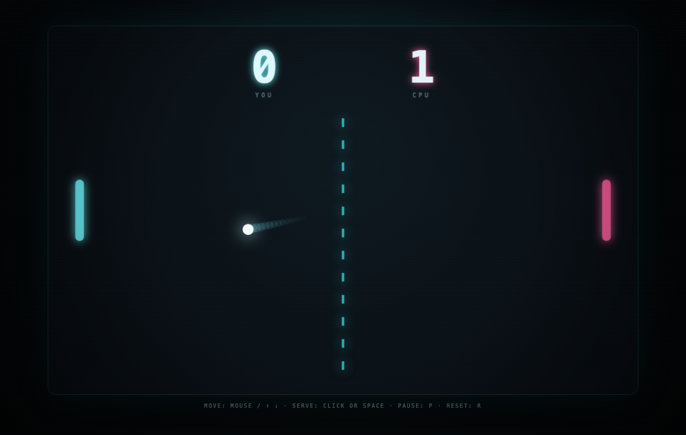

# Classic Pong

A neon, retro-minimalist take on Pong in a single HTML file. No build step, no
dependencies — just HTML5 Canvas and vanilla JavaScript.



## Play

Open `index.html` in any modern browser:

```sh
open index.html
```

Or serve the folder:

```sh
python3 -m http.server 8000
# then visit http://localhost:8000
```

## Controls

| Action | Input |
| --- | --- |
| Move paddle | Mouse / touch, or `↑` `↓` (also `W` `S`) |
| Serve / restart | Click or `Space` |
| Pause | `P` or `Esc` |
| Reset match | `R` |

## How it plays

- You defend the left side; a predictive AI defends the right.
- The ball speeds up on every paddle hit and bounces off walls.
- Where the ball strikes the paddle sets the return angle.
- The AI aims for the ball's predicted path but is limited by paddle speed and
  reaction time, so long rallies are winnable.
- First to 7 points wins.

## Details

- Fixed 960×600 logical resolution, scaled to fit; sharp on HiDPI screens.
- Delta-time physics with substepping so fast balls never tunnel through paddles.
- All visuals drawn on canvas: glowing net, ball trail, hit flashes, particles.

## License

MIT
