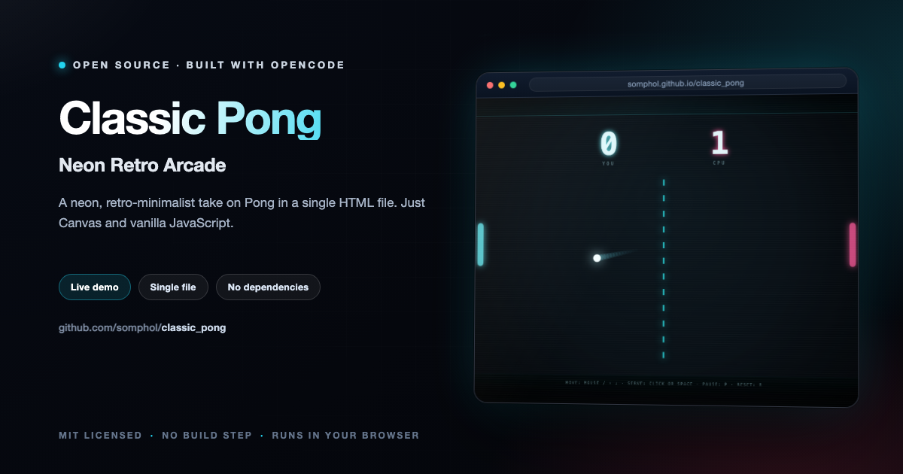

<div align="center">



# Classic Pong

**Neon Retro Arcade**

A neon, retro-minimalist take on Pong in a single HTML file — just HTML5 Canvas and vanilla JavaScript.

[](https://somphol.github.io/classic_pong/)
[](LICENSE)

**[Try it live →](https://somphol.github.io/classic_pong/)**

</div>

---

## Run locally

Open `index.html` in any modern browser:

```sh
open index.html
```

Or serve the folder:

```sh
python3 -m http.server 8000
# then visit http://localhost:8000
```

## Controls

| Action | Input |
| --- | --- |
| Move paddle | Mouse / touch, or `↑` `↓` (also `W` `S`) |
| Serve / restart | Click or `Space` |
| Pause | `P` or `Esc` |
| Reset match | `R` |

## How it plays

- You defend the left side; a predictive AI defends the right.
- The ball speeds up on every paddle hit and bounces off walls.
- Where the ball strikes the paddle sets the return angle.
- The AI aims for the ball's predicted path but is limited by paddle speed and
  reaction time, so long rallies are winnable.
- First to 7 points wins.

## Details

- Fixed 960×600 logical resolution, scaled to fit; sharp on HiDPI screens.
- Delta-time physics with substepping so fast balls never tunnel through paddles.
- All visuals drawn on canvas: glowing net, ball trail, hit flashes, particles.

## Contributing

Contributions are welcome — bug reports, feature ideas, accessibility improvements, and
documentation fixes alike. Please read [CONTRIBUTING.md](CONTRIBUTING.md) and the
[Code of Conduct](CODE_OF_CONDUCT.md) before opening a pull request.

- **Found a bug?** [Open a bug report](https://github.com/somphol/classic_pong/issues/new?template=bug_report.yml)
- **Have an idea?** [Request a feature](https://github.com/somphol/classic_pong/issues/new?template=feature_request.yml)
- **Found a vulnerability?** Please follow [SECURITY.md](SECURITY.md) and report it privately.

## Documentation

| Document | Purpose |
| --- | --- |
| [README.md](README.md) | Overview, setup, controls, and architecture |
| [AGENTS.md](AGENTS.md) | Handoff for the next maintainer or agent |
| [docs/ARCHITECTURE.md](docs/ARCHITECTURE.md) | File layout, state machine, physics, AI, rendering |
| [docs/REPRODUCTION.md](docs/REPRODUCTION.md) | How to rebuild the game from scratch |
| [docs/DEPLOYMENT.md](docs/DEPLOYMENT.md) | GitHub Pages hosting, checks, rollback |
| [docs/TESTING.md](docs/TESTING.md) | What was verified, manual gameplay matrix |
| [CHANGELOG.md](CHANGELOG.md) | Notable changes and release history |
| [CONTRIBUTING.md](CONTRIBUTING.md) | Local workflow, constraints, and pull request checks |
| [SECURITY.md](SECURITY.md) | Supported versions and private vulnerability reporting |
| [LICENSE](LICENSE) | MIT licence |

## License

MIT
